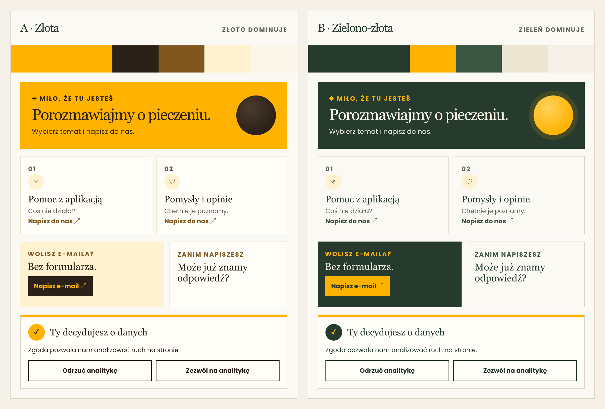

# Just Bread homepage

Live site: [https://justbread.app/](https://justbread.app/)

Implementation of UI created by Iwona Poprawska-Krzymyk [Figma](https://www.figma.com/file/wKzkSA3qykTvhYUZzB1Qis/Just-Bread-%7C-Iwona-Krzymyk?node-id=49%3A346) for Just Bread app.

## Tech stack:

Vue 3 + Typescript + Vite + TailwindCss + i18n

## Start app:

Install volar extention in vscode, then run:

```bash
npm install
npm run dev
```

You can reach the app under 5137 port:

```
http://127.0.0.1:5173/#/
```

## SEO configuration

Set `VITE_SITE_URL` to the public, canonical site URL without a trailing slash. It is used for canonical links and structured data. The production workflow sets it to `https://justbread.app`; update both [`.env.example`](.env.example) and the deployment workflow if the canonical domain changes.

## Design systems

Static, self-contained HTML references (open them directly in a browser) live in [`design-systems/`](design-systems/). They are discussion material and are not part of the Vite build.

[](design-systems/design-system-comparison.html)

| File | Contents |
| --- | --- |
| [`design-system-before.html`](design-systems/design-system-before.html) | Previous system (archive) |
| [`design-system-proposed.html`](design-systems/design-system-proposed.html) | Gold system (`#FFB300` hero, dark brown ink); used by the FAQ page |
| [`design-system-green-gold.html`](design-systems/design-system-green-gold.html) / [`.pl.html`](design-systems/design-system-green-gold.pl.html) | Evergreen + gold system with an accessibility section (EN / PL); used by the Contact page |
| [`design-system-comparison.html`](design-systems/design-system-comparison.html) | Gold vs. evergreen + gold: WCAG contrast, pros and cons, recommendation (PL) |
| [`design-system-dark.html`](design-systems/design-system-dark.html) | Dark-mode extension of both systems, with tokens and contrast ratios (PL) |

The app pages are currently styled with these systems via per-page CSS variables in `src/pages/Faq.vue` (gold), `src/pages/Contact.vue` (evergreen + gold) and `src/App.vue` (consent card, gold). Dark mode is not implemented in the app yet.

## Tests

Run the frontend test suite once:

```bash
npm test
```

Run tests in watch mode during development:

```bash
npx vitest
```

## Quality checks

Before opening a pull request, run the linter, test suite, and production build:

```bash
npm run lint
npm test
npm run build
```

## Type Support For `.vue` Imports in TS

Since TypeScript cannot handle type information for `.vue` imports, they are shimmed to be a generic Vue component type by default. In most cases this is fine if you don't really care about component prop types outside of templates. However, if you wish to get actual prop types in `.vue` imports (for example to get props validation when using manual `h(...)` calls), you can enable Volar's Take Over mode by following these steps:

1. Run `Extensions: Show Built-in Extensions` from VS Code's command palette, look for `TypeScript and JavaScript Language Features`, then right click and select `Disable (Workspace)`. By default, Take Over mode will enable itself if the default TypeScript extension is disabled.
2. Reload the VS Code window by running `Developer: Reload Window` from the command palette.

You can learn more about Take Over mode [here](https://github.com/johnsoncodehk/volar/discussions/471).
